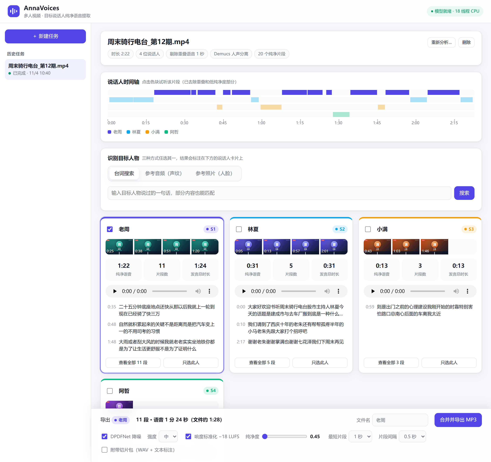
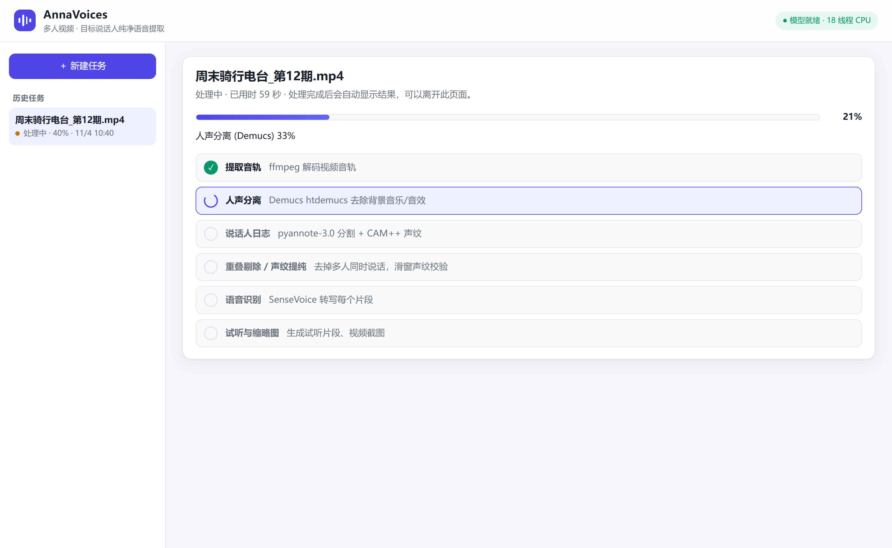
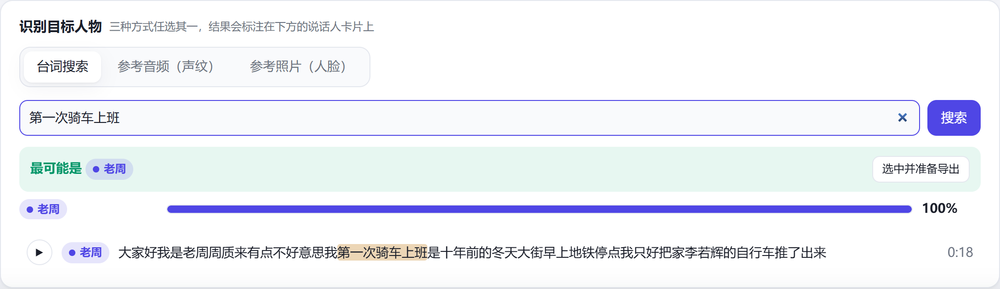
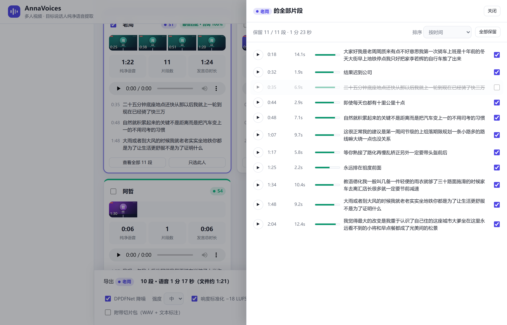
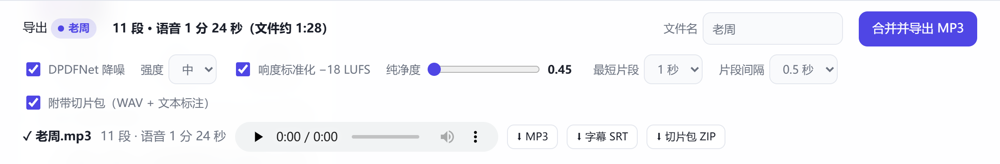

# AnnaVoices

**把多人视频里某一个人的声音，干净地提取成一个 MP3。**

*Extract one person's clean voice from a multi-speaker video — a local web app that separates speakers, drops overlapping speech, and exports a single MP3 ready for TTS or voice-clone training.*

上传一段播客、访谈或会议录像 → 自动分出每位说话人 → 你选定目标人物 → 一键导出只有 TA 声音的纯净音频（附字幕，可选切片包）。全程在本机 CPU 运行，无需 GPU，无需任何账号或 Token。



<sub>截图来自真实运行结果。演示视频是专门制作的虚构节目，人物和声音均为合成，所以台词里有一些语音识别错字。</sub>

## 它解决什么问题

想用某个人的声音训练 TTS，最麻烦的不是训练，而是准备数据：视频里总有别人插话、抢话，还有背景音乐。手工剪一小时的节目要花很多时间，而且很难剪干净。AnnaVoices 把这件事自动化：

- **分清谁在说话**：自动判断人数，只说了几秒的配角也会单独分出来，不会混进主讲人。
- **只留下纯净语音**：去除背景音乐和重叠语音，逐帧校验声纹，有疑问的部分宁可丢弃。
- **轻松找到目标人物**：可以试听，也可以用一句台词、一段参考录音或一张照片自动匹配。
- **导出即可训练**：降噪、响度标准化后合并成一个 MP3，同时生成字幕和可选的 WAV 切片包。

## 使用流程

<table>
  <tr>
    <td width="50%" valign="top"><b>1. 上传视频</b><br>拖入任意 ffmpeg 能解码的音视频文件，人数可以自动估计。<br><br></td>
    <td width="50%" valign="top"><b>2. 等待处理</b><br>任务在后台运行，分阶段显示进度，可以关掉页面稍后回来。<br><br></td>
  </tr>
  <tr>
    <td width="50%" valign="top"><b>3. 确认目标人物</b><br>输入一句记得的台词（部分内容也能匹配），或上传参考录音 / 照片。<br><br></td>
    <td width="50%" valign="top"><b>4. 逐段复核（可选）</b><br>试听每个片段，看纯净度，取消勾选不想要的部分。<br><br></td>
  </tr>
  <tr>
    <td colspan="2" valign="top"><b>5. 合并导出</b><br>设置降噪、响度、纯净度和片段间隔，下载 MP3、字幕 SRT 和切片包 ZIP。同一人被分成两个说话人时，可以多选后一起导出。<br><br></td>
  </tr>
</table>

## 快速开始

需要 **Python 3.10+** 和 **ffmpeg**（在 PATH 中即可）。

**Windows**：双击 [`start.bat`](start.bat)。首次运行会创建虚拟环境、安装依赖并下载约 300 MB 模型，完成后浏览器自动打开 <http://127.0.0.1:8765>。

**手动安装**：

```bash
py -3.12 -m venv .venv
.venv\Scripts\python -m pip install torch torchaudio --index-url https://download.pytorch.org/whl/cpu
.venv\Scripts\python -m pip install -r requirements.txt
.venv\Scripts\python -m voiceextract.models          # 下载模型到 ./models
.venv\Scripts\python -m voiceextract.server --open   # http://127.0.0.1:8765
```

项目在 Windows 11 上开发和测试。代码没有依赖 Windows 专有功能，但 macOS / Linux 尚未测试，路径需要相应调整。

### 命令行

```bash
# 分析（任务保存在 jobs/<job>/，同样会出现在网页的任务列表里）
.venv\Scripts\python -m voiceextract.cli analyze interview.mp4 --job demo [--speakers 4] [--no-separate]
# 确认身份：按台词或参考音频
.venv\Scripts\python -m voiceextract.cli identify --job demo --text "目标人物说过的一句话" [--audio ref.wav]
# 导出
.venv\Scripts\python -m voiceextract.cli export --job demo --speaker S1 --name target --slices --out output/target.mp3
```

## 输出内容

| 文件 | 说明 |
| --- | --- |
| `<名字>.mp3` | 目标人物的纯净语音：320 kbps / 44.1 kHz / 单声道，−18 LUFS，片段之间有静音，方便切片工具分段 |
| `<名字>.srt` | 与 MP3 时间轴对齐的逐段转写 |
| `<名字>_slices.zip` | 可选：WAV 切片 + `list.txt`（`路径\|说话人\|ZH\|文本`，这是 GPT-SoVITS 等工具常用的标注格式） |

## 工作原理

```
视频 ──ffmpeg──▶ 44.1k 立体声 ──Demucs htdemucs──▶ 人声轨
                                                    │ 重采样 16 kHz
                                                    ▼
      pyannote-3.0 分割 + CAM++ 声纹（sherpa-onnx）：语音活动 / 话轮边界 / 重叠语音
                                                    ▼
      refine：① 去除重叠语音（≥2 人同时说话，前后各加 0.1 s 保护带）；话轮边界向无人占用的帧外扩 0.25 s，
                 再与 Silero VAD（前后 0.15 s）取交集，保住词首辅音；≤0.5 s 的停顿合并，>15 s 的长句在最长停顿处切开
              ② 声纹换人检测：1 s 窗、0.25 s 步长，比较每个时间点前后 1.75 s 的声纹，相似度 < 0.4 处切开
                 （弥补 pyannote 在快速插话时漏掉的换人点）
              ③ 1.5 s 滑窗 CAM++ 声纹 → 自调谱聚类：按拉普拉斯特征值最大间隔（eigengap）确定主要说话人数，
                 不依赖任何绝对阈值；声纹中心相似度 > 0.7 的簇合并
              ④ 次要说话人：与所有主要说话人都不像（< 0.3）的片段单独成组；
                 占全部纯净语音 ≥ 1% 的组列为说话人，其余视为笑声 / 插话等零散声音，从所有人中排除
              ⑤ 逐帧标注：每帧归属于覆盖它的滑窗最像的说话人，且相似度 ≥ 0.45、比第二像的人高出 ≥ 0.2
                 才保留；换人处自动切段
                                                    ▼
      SenseVoice 转写每个纯净片段（用于确认身份、台词搜索、导出字幕 / 标注）
                                                    ▼
      导出：DPDFNet 48 kHz 降噪（逐段，可调衰减上限）→ 10 ms 淡入淡出 → 片段间插入静音
            → EBU R128 双遍响度标准化（−18 LUFS，真峰值 −1.5 dBTP）→ LAME 320 kbps MP3
```

设计要点：

- **说话人数自适应**：sherpa-onnx 自带的快速聚类在长节目上严重过分割（52 分钟节目被分成 111 类），固定阈值又会在短视频上把配角并进主角（83 秒三人访谈曾被识别成 1 人）。这里只用它的语音活动、话轮边界与重叠信息，说话人由谱聚类自动确定，再单独找出只说了几秒的次要说话人。
- **中英文通用声纹**：使用 3D-Speaker `campplus_sv_zh_en_16k-common_advanced`；在英文访谈中，不同人之间的相似度从 0.28–0.35 降到 0.09–0.17，中文节目的结果不变。
- **宁缺毋滥**：TTS 训练数据对纯度比时长更敏感，所以重叠语音整段剔除，换人点切开，逐帧校验不通过的部分直接丢弃。
- **指定人数**：在界面或 `--speakers N` 中给出的人数只作为上限和补足依据，不会为了凑人数强行拆开主讲人。
- **缓存**：人声分离和说话人日志的结果保存在任务目录中，用不同人数“重新分析”很快。

### 测试结果

| 测试素材 | 识别结果 | 校验方式 |
| --- | --- | --- |
| 52 分钟中文圆桌节目 | 4 位说话人，纯净语音约 39 分钟 | 用另一个声纹模型复核，全部片段一致 |
| 83 秒英文三人访谈（快速插话） | 3 位说话人 | 同上，全部片段一致 |
| 2 分 23 秒合成语音节目（本页截图） | 4 位说话人 | 与脚本对照，所有纯净片段都归属正确 |

### 项目结构

```
start.bat               一键安装 + 启动（Windows）
requirements.txt
voiceextract/
  pipeline.py           处理管线（分离 / 日志 / 提纯 / 转写 / 匹配 / 导出）
  server.py             FastAPI 后端 + 任务队列，托管 web/
  cli.py                命令行入口
  jobs.py               任务目录存储
  models.py             模型清单与下载
web/                    单页应用（原生 HTML/CSS/JS，无需构建）
docs/screenshots/       本页截图
```

运行时生成、不纳入版本库的目录：`models/`（下载的模型）、`jobs/`（每个任务的音频缓存和结果）、`output/`（命令行导出）。

### 使用的模型

| 用途 | 模型 |
| --- | --- |
| 人声分离 | Demucs v4 `htdemucs`（首次使用时自动下载） |
| 语音分割 / 重叠检测 | pyannote `segmentation-3.0`（sherpa-onnx 导出版） |
| 声纹 | 3D-Speaker `campplus_sv_zh_en_16k-common_advanced` |
| VAD | Silero VAD v5 |
| 语音识别 | SenseVoice Small（int8，2025-09-09） |
| 降噪 | DPDFNet `dpdfnet2_48khz_hr`（48 kHz 全频带） |
| 人脸（仅照片匹配） | OpenCV Zoo YuNet + SFace |

## 已知限制

- **速度**：纯 CPU 运行（Core Ultra 9 185H 实测）时，52 分钟视频的人声分离约 25 分钟，其余阶段约 7 分钟，导出约 2 分钟；83 秒视频全流程约 1 分钟。不需要去背景音乐时可以关闭人声分离。
- **音质上限**：输出质量取决于原视频。例如 128 kbps AAC 音源在 15.5 kHz 以上没有内容，导出 320 kbps 也不会补回来。
- **照片匹配**依赖“镜头对着正在说话的人”这一惯例，低分辨率视频上可靠性会下降，建议再试听确认。
- **转写文本**自动生成，没有标点，可能有同音错字；用作训练标注前建议抽查。
- **只说了一两秒**、且大多与他人重叠的说话人证据很少：可能被识别为独立说话人，也可能归入“零散声音”被排除，但不会混入主讲人的音频。

## 负责任地使用

请只处理你有权使用的内容。提取或克隆他人的声音之前，请取得本人同意，并遵守所在地法律和相关平台的规定。不要用它冒充他人或制造误导性内容。
